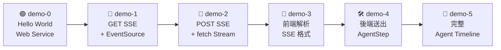
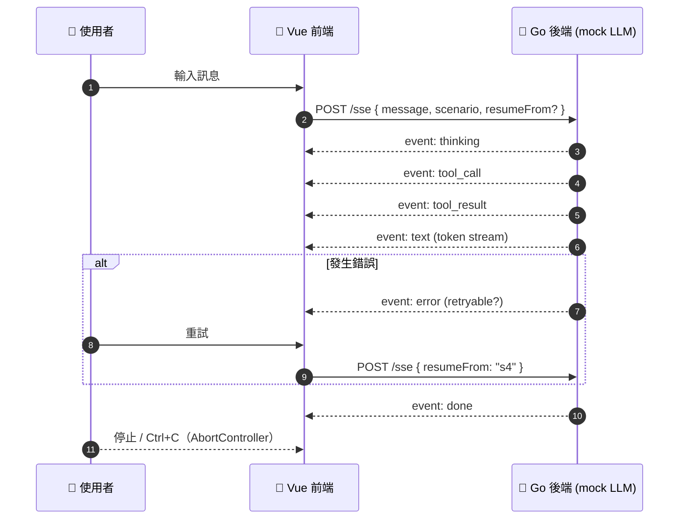

<div align="center">

# 🤖 為 Agentic AI 設計前端狀態機與即時回饋介面

**Hello World Dev Workshop**

從一個 `hello world` 開始，一步步用 **SSE (Server-Sent Events)** 打造一個能即時顯示 Agent 思考、呼叫工具、串流回答的前端介面。

[](https://go.dev/)
[](https://vuejs.org/)
[](https://www.typescriptlang.org/)
[](https://vite.dev/)
[](https://bun.sh/)
[](./LICENSE)

</div>

> [!IMPORTANT]
> 🏛️ **本 workshop 為「文藝復興活動」** —— 不靠 AI 補全，從手寫開始。
> 需要手動撰寫程式碼，以達到學習目的。

---

## 📑 目錄

- [課程地圖](#-課程地圖)
- [資料夾結構](#-資料夾結構)
- [Demo 內容](#-demo-內容)
  - [demo-0：小試身手](#demo-0小試身手)
  - [demo-1：製作 SSE 服務並與前端接起來](#demo-1製作-sse-服務並與前端接起來)
  - [demo-2：改用 fetch 讀取 ReadableStream](#demo-2改用-fetch-讀取-readablestream後端改為-post-sse)
  - [demo-3 / 4：解析 SSE 文字格式、依 event 分派 callback](#demo-3--4解析-sse-文字格式依-event-分派-callback)
  - [demo-5：完整的 Agent Timeline](#demo-5完整的-agent-timeline)
- [常見指令](#️-常見指令)
- [License](#-license)

---

## 🗺️ 課程地圖



| Demo | 主題 | 後端 (Go) | 前端 (Vue) |
| :---: | --- | :---: | :---: |
| [**0**](./demo-0) | 小試身手 | ✅ | — |
| [**1**](./demo-1) | SSE 服務 + `EventSource` | ✅ | ✅ |
| [**2**](./demo-2) | `fetch` + `ReadableStream` | ✅ | ✅ |
| [**3**](./demo-3) | 前端解析 SSE 訊息 | — | ✅ |
| [**4**](./demo-4) | 後端改用 `AgentStep` | ✅ | — |
| [**5**](./demo-5) | 完整 Agent Timeline（展示用） | ✅ | ✅ |

---

## 📂 資料夾結構

demo-1 ~ demo-4 都提供三種難度，可以依照自己的程度挑選：

| 資料夾 | 說明 |
| --- | --- |
| 📝 `todo版` | 已經挖好空，照著 `TODO` 填寫即可 |
| 🔥 `困難版` | 幾乎從零開始，挑戰自己 |
| ✅ `解答` | 完整的參考解答 |

```text
.
├── demo-0/              # Go hello world
├── demo-1/ ~ demo-4/
│   ├── todo版/          # backend/ + frontend/
│   ├── 困難版/
│   └── 解答/
└── demo-5/
    └── 解答/            # 只有解答（展示用）
```

---

## 📚 Demo 內容

### demo-0：小試身手

> 🎯 **Objective**：製作一個 hello world dev 的 web service

---

### demo-1：製作 SSE 服務並與前端接起來

> 🎯 **Objective**：讓前端可以即時收到後端推送的時間

- **🐹 Go（後端）**：加入 `GET` SSE 的服務，每一秒回傳 RFC3339 格式的當下時間
- **💚 Vue（前端）**：製作 `EventSource` 接起後端的 message

---

### demo-2：改用 fetch 讀取 ReadableStream（後端改為 POST SSE）

> 🎯 **Objective**：從 `EventSource` 換成 `fetch`，以支援 `POST` 帶入 body

- **💚 Vue（前端）**：`EventSource` ➜ `fetch`，並且 `console` 出後端的 stream 結果

---

### demo-3 / 4：解析 SSE 文字格式、依 event 分派 callback

#### demo-3：處理前端收到的訊息

> 🎯 **Objective**：整理 `fetch` 收到的串流資料

- **💚 Vue（前端）**：整理改為 `fetch` 後的資料處理問題

#### demo-4：處理後端送出的訊息

> 🎯 **Objective**：讓後端以結構化的步驟送出訊息

- **🐹 Go（後端）**：後端改用 `AgentStep` 的方式把訊息傳出去

---

### demo-5：完整的 Agent Timeline

> [!NOTE]
> 本 demo 為**展示用，只有解答**。

> 🎯 **Objective**：把前面的內容組合成一個完整的 Agent 前端



<details open>
<summary><b>🐹 Go（後端）</b></summary>

- mock LLM 三種 scenario：`search_and_calc`、`multi_tool`、`error_retry`
- 事件改成 `thinking` / `tool_call` / `tool_result` / `text` / `error` / `done`
- data 改成 JSON
- 支援 `resumeFrom` 從指定 step 重跑

</details>

<details open>
<summary><b>💚 Vue（前端）</b></summary>

- `AgentEvent` / `AgentStep` discriminated union + `assertNever` 窮舉檢查
- 符合 SSE 規格的 parser（註解行、未知欄位、`\r\n`、結尾剩餘 buffer）
- text token 以 16ms throttle 合批更新（畫面上可以切換開關、比較 re-render 次數）
- `AgentTimeline` 元件：每種 step 一個 template 分支、閃爍游標、工具 spinner、錯誤狀態
- `AbortController`：「停止」按鈕或 `Ctrl+C` 取消問答，依 `retryable` 決定能否重試，並從指定 step 恢復

</details>

**🧪 測試指令**

```sh
curl -N http://localhost:8080/sse -X POST -d '{"message":"Hi","scenario":"error_retry"}'
curl -N http://localhost:8080/sse -X POST -d '{"message":"Hi","scenario":"error_retry","resumeFrom":"s4"}'
```

---

## 🛠️ 常見指令

### 💚 前端

啟動前端的專案：

```sh
bunx create-vite@latest --template vue-ts <專案名稱>
# 這會把 vue 的框架弄出來，我們會在 src/App.vue 上面實作
```

### 🐹 後端

初始化後端 Golang 專案：

```sh
go mod init <專案名稱>
touch main.go # 創建一個 main.go 的檔案，我們會在 main.go 上面實作
```

### 🧪 測試後端（demo-3 之後）

```sh
curl -N http://localhost:8080/sse -X POST -d '{"message": "Hi" }'
```

---

## 📄 License

本專案採用 [MIT License](./LICENSE)。

<div align="center">

Made with ❤️ for **Hello World Dev** · ⭐ 如果覺得有幫助，歡迎給個 Star！

</div>
